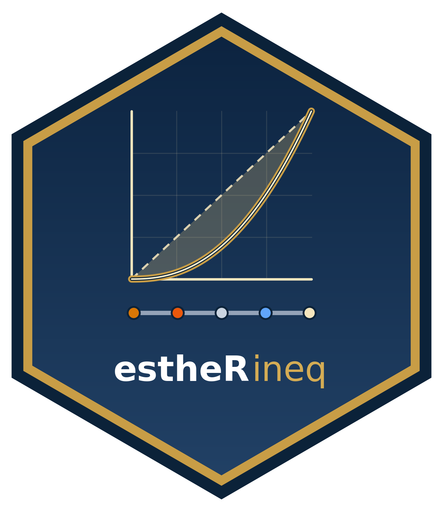

# estheRineq <a href="https://ahernandezv.github.io/estheRineq/"></a>

<!-- badges: start -->
[](https://github.com/ahernandezv/estheRineq/actions/workflows/R-CMD-check.yaml)
[](https://CRAN.R-project.org/package=estheRineq)
[](https://www.gnu.org/licenses/gpl-3.0)
<!-- badges: end -->

**`estheRineq`** (*Epidemiological Statistics Toolkit for Health Inequality Estimation and Reporting in R*) is a zero-dependency-core scientific R package (and companion to Python [`esther-ineq`](https://pypi.org/project/esther-ineq/)) uniting **complex-survey health econometrics** (World Bank *Analyzing Health Equity*, Stata `conindex` / `lorenz` / `oaxaca_rif`, R `convey` / `rineq`) and **epidemiological health inequality surveillance & reporting** (WHO Health Inequality Monitor `healthequal` / HEAT, Pelotas ICEH `equiplot`, UKHSA `PHEindicatormethods`, Moreno-Betancur GLMs, and **STROBE-Equity 2025**).

---

## Installation / Instalación

```r
# From GitHub:
# install.packages("remotes")
remotes::install_github("ahernandezv/estheRineq")

# Or from R-universe (once enabled):
# install.packages("estheRineq", repos = c("https://ahernandezv.r-universe.dev", "https://cloud.r-project.org"))
```

---

## Key Capabilities (`v0.1.0`)

| Module | Functions | Methodological Highlights |
| :--- | :--- | :--- |
| **Survey & Grouped Containers** | `survey_health_data()`, `grouped_health_data()`, `xtile()`, `compute_fractional_ranks()` | Stratified multistage cluster designs (`weights`, `strata`, `psu`, `fpc`, replicate weights), native `survey::svydesign` adapter, and tie-exact midpoint ridit ranks. |
| **Concentration & Classical Suite** | `concentration_index()`, `concentration_curve()`, `classical_inequality()`, `decompose_subgroup_ge()`, `survey_mean()` | Standard, generalized, modified, Wagstaff, Erreygers, extended (`v`), and symmetric (`beta`) CIs with exact `O(N log N)` influence functions + omnibus domain Wald *F*-tests; Gini, S-Gini, Atkinson, GE/Theil/MLD, Palma, and S80/S20. |
| **WHO 21 & Epidemiological SII/RII** | `who_summary()`, `sii_rii()` | All 21 WHO Health Inequality Monitor (`healthequal` / HEAT) summary measures; logistic G-computation marginal `SII`/`RII`, Moreno-Betancur GLMs, and WLS. |
| **Standardization & Horizontal Inequity** | `direct_standardize()`, `indirect_standardize()`, `standardize_health_need()`, `horizontal_inequity()` | `DSR`, `SMR`, and `ISR` with Dobson/Byar Poisson-Gamma CIs and built-in WHO/Segi/European standards; Gravelle-consistent nonlinear need standardization (`HI`). |
| **Inequality Decompositions** | `decompose_wagstaff()`, `decompose_rif()`, `decompose_oaxaca_rif()` | Reference-category-invariant Wagstaff GLM decomposition, bivariate `RIF-I-OLS`, and counterfactual `RIF-Oaxaca` with optional IPW reweighting and Rao-Wu-Yue PSU bootstrap. |
| **Visualizations & STROBE-Equity** | `equiplot()`, `plot_curve()`, `plot_sii_gradient()`, `plot_decomposition()`, `funnel_plot()`, `to_markdown()`, `to_latex()`, `to_excel()`, `to_word()` | Sentence-case publication graphics (`ggplot2` or zero-dependency base R) with dynamic variable names, Pelotas pattern diagnostics, and trilingual (`en`, `es`, `pt`) exports. |

---

## Quick Start / Uso Rápido

### 1. Complex-Survey Health Inequalities & Decompositions

```r
library(estheRineq)

# Built-in DHS/ENDES-style complex survey dataset (n = 1,200; 6 strata; 60 PSUs)
svy <- survey_health_data(
  data = survey_mch,
  weights = "sample_weight",
  strata = "stratum_id",
  psu = "cluster_id"
)

# Erreygers concentration index across urban vs. rural domains + Wald F-test
res_ci <- concentration_index(
  svy,
  outcome = "stunting",
  rank = "wealth_score",
  method = "erreygers",
  by = "area",
  favorable = FALSE
)
print(res_ci) # Default English; pass lang = "es" or lang = "pt" if needed

# Epidemiological SII & RII + LaTeX booktabs table
res_sii <- sii_rii(
  svy,
  outcome = "full_immunization",
  rank = "wealth_quintile",
  favorable = TRUE,
  scale = 100
)
cat(to_latex(res_sii))

# Reference-invariant Wagstaff decomposition
decomp <- decompose_wagstaff(
  svy,
  formula = stunting ~ mother_edu + area + improved_sanitation + child_age_mo,
  rank = "wealth_score",
  method = "erreygers",
  bootstrap_reps = 200
)
plot(decomp)

# Pelotas equiplot directly from survey microdata (or wide subgroup columns)
equiplot(
  svy,
  outcome = "full_immunization",
  subgroup = "wealth_quintile",
  by = "region",
  scale = 100,
  diagnose_pattern = TRUE,
  sort_by = "gap"
)
```

### 2. Disaggregated Surveillance Tables (`who_disaggregated` & `district_mortality`)

```r
library(estheRineq)

# All 21 WHO Health Inequality Monitor summary measures from subgroup estimates
w_sub <- subset(who_disaggregated, dimension == "wealth_quintile")
gd <- grouped_health_data(
  w_sub,
  subgroup = "subgroup",
  estimate = "estimate",
  se = "se",
  population = "population",
  ordered = TRUE,
  favorable = TRUE,
  scale = 100
)
who_summary(gd, measures = c("d", "r", "par", "paf", "sii", "rii", "aci", "rci"))

# Directly standardized district mortality rates + Spiegelhalter funnel plot
dsr <- direct_standardize(
  district_mortality,
  events = "deaths",
  population = "population",
  stratum = "age_group",
  group = "district",
  standard_pop = "who_broad_5"
)
funnel_plot(dsr)
```

---

## Methodological Credits & References

- **ICEH Pelotas Equiplot & Inequality Patterns:** International Center for Equity in Health (ICEH), Federal University of Pelotas (`equidade.org/equiplot`; Barros & Victora).
- **WHO Health Inequality Monitor:** Schlotheuber & Hosseinpoor (2022), *International Journal of Environmental Research and Public Health* (`healthequal` / HEAT).
- **Rank-Dependent Concentration Indices & Decompositions:** O'Donnell, van Doorslaer, Wagstaff & Lindelow (2008); O'Donnell, O'Neill, Van Ourti & Walsh (2016, `conindex`); Heckley, Gerdtham & Kjellsson (2016); Ríos-Ávila (2020, `oaxaca_rif`).
- **Epidemiological SII, RII, and Reporting:** Moreno-Betancur et al. (2015); Welch et al. (2025, `STROBE-Equity`).

---

## Citation

If you use `estheRineq` in academic publications, teaching, or technical reports, please cite:

```r
citation("estheRineq")
```

- Hernández-Vásquez, A. (2026). *estheRineq: Epidemiological Statistics Toolkit for Health Inequality Estimation and Reporting in R*. R package version 0.1.0. <https://github.com/ahernandezv/estheRineq>

---

## Acknowledgments

This work was supported in part by complimentary access to Google Antigravity and Gemini 4 Argon to accelerate scientific workflows.
